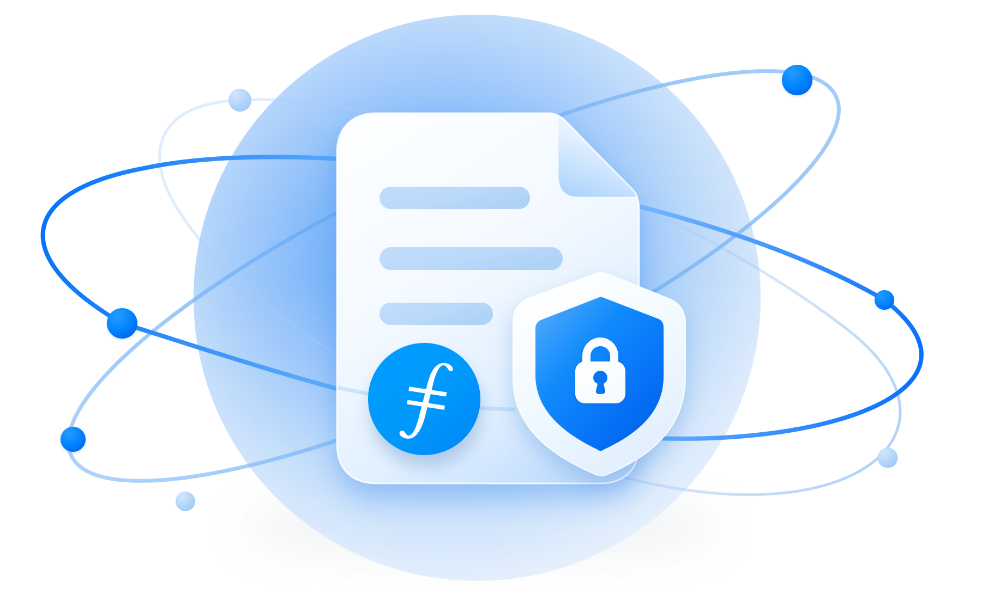

<p align="center">
  
</p>

<h1 align="center">filecoin-encryption-viewer</h1>

<p align="center">
  Open encrypted Filecoin shares in your browser. Decryption never leaves the page.
</p>

<p align="center">
  <a href="#try-it">Try it</a> ·
  <a href="#opening-a-share">Opening a share</a> ·
  <a href="#usage">Usage</a> ·
  <a href="#test-locally">Test locally</a> ·
  <a href="#verifiable-build">Verifiable build</a> ·
  <a href="#credits">Credits</a>
</p>

A single-file browser viewer for encrypted Filecoin uploads (`filecoin-pin add --encrypt`), opened from the Share links filecoin-pin mints with [keysmith](https://github.com/FilOzone/synapse-sdk/tree/master/packages/keysmith). The build output is one self-contained `dist/index.html`, published once to IPFS and opened through [inbrowser.link](https://inbrowser.link). Decryption happens entirely in the recipient's browser. There's no server and no analytics, the Access key never leaves the page, and nothing is kept after you close it (large saves use temporary files that are deleted, see [Saving](#saving)).

## Try it

A demo folder on the calibration network, shared with `filecoin-pin get-share-link`, in both kinds of link:

- **[Open link](https://bafkreibthn4gniz2rjyi6rpcqn6lavpbdgok3w5dj2zghou4hem4bfuiqa.ipfs.inbrowser.link/#v1/bafybeifd567whjwnh5aoxucilqtra7mmzqfbjdxt35ytxwbt5kqqbmx7re&d=pwABAXgocGllY2U6MHgyNzM3MGMzZjgzNTRmYzZmZjJkMzFkNjIzMWZhZjJmMwJUsmE-AvIy0AvPBgwscKm2DQkwlZoDUIeaTjPUnDLnBrmADSbMFhUEWEEEpYpt3hrdlaAnCiP4YiwKDXozDXfeemRczk0aEHp0rJVwu-5t6TszxNiCbk0qPTBAB0_fYIzUBWG6M3DYE7nkXAVMkxAhCxk_8kqJrukEBlgwSIRvPBRWpfeNsXJfJBjZ9GRZanVKk1AbL3wHJcGZKsJV0uY75TFJMK5Rjv1iLjRr&k=fak1_Qu3jLRHpui6T3_k7cvhr3F1uHugu16fETsJrN8MKCPk)**: carries its Access key, so it opens without a prompt.
- **[Restricted link](https://bafkreibthn4gniz2rjyi6rpcqn6lavpbdgok3w5dj2zghou4hem4bfuiqa.ipfs.inbrowser.link/#v1/bafybeifd567whjwnh5aoxucilqtra7mmzqfbjdxt35ytxwbt5kqqbmx7re&d=pwABAXgocGllY2U6MHgyNzM3MGMzZjgzNTRmYzZmZjJkMzFkNjIzMWZhZjJmMwJUsmE-AvIy0AvPBgwscKm2DQkwlZoDUIeaTjPUnDLnBrmADSbMFhUEWEEE7YM_C2ak6J1pHLoyjTIE3qtXUMO1ew0XpS7jJLUS2zACh0ktqF1KJbtNERiaZhknsGD-MwBAqT3UlyaMCYx3PgVMLGj6m6OtUqLU3T00BlgwvXMm9WJ9vCMblw_uiYFdAQgwrxkVxsbRJOT9I6g9UXHCfDZJQ11Il6Jz-u4p4oqR)**: asks for its Access key, `fak1_txekkuXRme36QrbqRN_uvG91DBa8OhpCJShw8MsJcEg`.

> [!WARNING]
> This Access key is public only because it's a demo. For a real share, send the Access key on a separate channel from the link, never next to it.

The first visit takes a few seconds while inbrowser.link sets up its service worker.

## Screenshots

<table>
  <tr>
    <td align="center" width="50%">
      <picture>
        <source media="(prefers-color-scheme: dark)" srcset="docs/screenshots/unlock-dark.png" />
        
      </picture>
      <br />
      <sub>The Access key prompt</sub>
    </td>
    <td align="center" width="50%">
      <picture>
        <source media="(prefers-color-scheme: dark)" srcset="docs/screenshots/files-dark.png" />
        
      </picture>
      <br />
      <sub>A shared folder, with "Download all"</sub>
    </td>
  </tr>
</table>

## Opening a share

1. Open the Share link you were sent.
2. If it asks for an Access key, paste the `fak1_…` key the sender gave you separately. An open link carries its key and skips this step.
3. Browse the files, preview them, and download one or all of them.

The link opens that one upload only. To open a share from a terminal or a script instead, use `filecoin-pin get --share '<link>'`.

## Usage

```text
https://<viewer-cid>.ipfs.inbrowser.link/#v1/<encrypted-root-cid>&d=<payload>[&k=fak1_<access key>]
```

This is exactly what `filecoin-pin get-share-link` writes. Everything is in the fragment, so nothing reaches a server, and every value is base64url without padding.

- `d` is the keysmith payload: the upload's key wrapped to a throwaway secp256k1 key T that the sender made for this link. It's one of two kinds, told apart by the CBOR type of its first byte:
  - a **plain piece grant** (`encodeGrant`, a CBOR map): the wrapped key alone. This is what filecoin-pin writes, from the owner wallet and from a session key with a Grant;
  - a **Delivery** (`encodeDelivery`, a CBOR array): an owner-signed claim chain naming T's address as its bearer, with an expiry, plus the wrapped key. filecoin-pin doesn't write these yet; the viewer accepts them for when storage providers gate retrieval.
- `k` is the **Access key**: `fak1_` plus the 32 bytes of T's private key (43 characters). An open link carries it; a restricted link doesn't, and the sender sends the Access key separately.

The viewer accepts `d` then `k` in that order, `d` up to 8192 characters, and nothing else. A link with any other parameter, a repeated one, a missing or empty `d`, or bad base64url gets the incomplete-link message.

### Opening a link

With `k`, the viewer clears it from the address bar (keeping `d`) before it fetches anything, so a reload or a copy of the address no longer carries the key, then opens the share with no prompt. If the key doesn't work it falls back to the prompt with a notice. Without `k`, it asks for the Access key and checks the pasted text first: whitespace is dropped, and a group key Grant (`fgr1_…`), a Share link, text without `fak1_` or a key of the wrong length is refused with its own message before anything else happens.

1. **Open the payload, before any request.** A Delivery goes through keysmith's `openDelivery` (chain signatures, expiry, T as the bearer, the key commitment, the grant naming the claim). A plain grant is unwrapped with `unwrapWith`. The grant must name one piece (`piece:<salt>`); a keyspace or scope grant is refused. A wrong Access key fails here, with nothing fetched.
2. **Read the envelope header** with Range requests: a chunked FEE envelope of a CAR.
3. **Derive the piece key** with `keyForEnvelope`, which checks the envelope's keysmith labels (owner, keyspace, salt) against the grant. The node key and T's bytes are zeroed once used; the piece key is zeroed when the share is closed, or on any failure.
4. **Read files** with `decryptRange`.

| Case | Message |
|---|---|
| Wrong Access key (doesn't unwrap, not the Delivery's bearer, or not a valid private key) | That Access key doesn't open this share |
| The payload is for another upload than the envelope at this CID | This link is for another upload |
| The Delivery has expired | This share has expired |
| The payload isn't a valid grant or Delivery, or a signature fails | This link is damaged |
| A chunk fails authentication (the ciphertext was modified) | This share was modified |
| The envelope has no keysmith labels, or isn't what `add --encrypt` writes | This link doesn't point to a filecoin-pin encrypted share |

No message names anything from inside the envelope.

The viewer fetches `https://<encrypted-root-cid>.ipfs.dweb.link/` with HTTP Range requests. inbrowser.link's service worker intercepts that request and serves it from the storage providers through IPNI, so the viewer only works when opened at an inbrowser.link origin. A share opened before IPNI has caught up shows "not available yet".

## Encryption format

The format is defined by filecoin-pin `add --encrypt`:

```text
outer CAR (public, IPNI)  ── UnixFS file, root = Encrypted root CID
  └─ FEE envelope (chunked scheme, filecoin-encryption-envelope)
       └─ inner CAR (unixfs-v1-2025, metadata-first), root = a wrapping directory
            with exactly one entry: the shared file, or the shared folder, under its own name
```

- The envelope's `content_type` is `application/vnd.ipld.car`. The inner CAR lists every directory and file node before any file data, so the viewer knows the whole tree, and every file's byte ranges, from the first few hundred KB.
- The envelope's authenticated `appMetadata` holds keysmith's piece labels (`pieceMetadata`): `foc/v` (1), `foc/own`, `foc/ks`, optionally `foc/scope`, and `foc/salt`. The piece key is derived from the keyspace key and the salt, so every upload has its own key, and a Share link opens only its own upload.
- File and folder names exist only inside the ciphertext. The on-chain piece name is `encrypted.fee`.

Key handling is [`@filoz/keysmith`](https://www.npmjs.com/package/@filoz/keysmith) 0.1.0 (with `viem`).

## Content rendering

The viewer reads the share with HTTP Range requests. It fetches only the metadata to show the tree (usually one request), and only a file's own ranges when you open it, in batches of up to 8 MiB. There is no cap on the share's size.

- **Single file:** opens straight into its file.
- **Folder:** shown as a tree under the folder's real name.
- **"← All files":** every file view of a folder share has this button. It returns to the tree from the already-open archive, with no new fetch and no new decryption, and remembers which folders were open.
- **"Download all":** streams a ZIP of the whole folder from the open archive (no re-decryption) and saves it as `<folder>.zip`, the same way as a single file.
- **File views:** each starts with the file name, a type label and the size, then the preview, then a Download button.

| Entry | Rendering |
|---|---|
| HTML up to 8 MiB | Static markup in an opaque-origin iframe; scripts, handlers, refresh, forms, embedded contexts, anchors, SVG animation and navigation/resource URLs are removed |
| Text up to 8 MiB, including SVG and XML | Shown as plain text, in a scrolling box |
| Raster image (JPEG, PNG, GIF, WebP, AVIF, BMP), audio or video up to 64 MiB | Inline browser preview with a Download button |
| PDF up to 64 MiB, starting with `%PDF-` | A panel with "Open PDF in a new tab" and a Download button |
| Unknown type | A download card: file name, "Unknown file type · size" and a Download button |
| Any larger entry | A save screen with the type, the size and a Download button |

The type is detected from a bounded sniff of the decrypted bytes, never from the file name. PDFs open in the browser's own PDF viewer in a new tab, with no inline preview, so the page CSP can forbid frames and plugins. Download links are always `application/octet-stream` blobs, so a decrypted HTML or SVG file opened from a link can't run script on the viewer's origin.

### Saving

| Browser | How a file is saved |
|---|---|
| Chrome, Edge, Brave (desktop) | The save dialog (`showSaveFilePicker`), streamed straight to disk |
| Firefox 111+, Safari 26+ | Decrypted into a temporary file in the browser's private storage (OPFS), with "Decrypting… N%" progress, then downloaded from disk. Memory stays low at any size |
| Private windows, older browsers | Built in memory, capped at 512 MiB on desktop and 256 MiB on mobile. Above that: "too large to save in this browser, use `filecoin-pin decrypt`" |

Temporary OPFS files are deleted at the next save, when the page starts, and when it's closed. If the server ignores Range and sends the whole file, the viewer offers that encrypted file as a download (`encrypted.fee`), to decrypt with `filecoin-pin decrypt`.

### Limits

A share must be exactly what `filecoin-pin add --encrypt` writes. The viewer rejects anything else as "not a filecoin-pin encrypted share", and it bounds the work a crafted share can cause. A real share over the entry or path limit gets "too many files, or folders nested too deeply, to open in the browser. Use `filecoin-pin get <CID>`."

| Limit | Value |
|---|---|
| Entries (files and folders) | 10,000 |
| Name / path length | 1024 / 4096 bytes |
| Metadata read before the tree shows | 16 MiB |
| Layout work | 1,000,000 visits |

## Development

Requires Node 24 and pnpm 10.7.0 (`packageManager`).

```sh
pnpm install --frozen-lockfile
pnpm dev
pnpm test
pnpm typecheck
pnpm build
```

### Test locally

`pnpm dev` alone has nothing to open. Make a local share first, then start the dev server:

```sh
pnpm dev:share ./some-folder   # or a single file
pnpm dev
```

`AGENTS.md` describes what it prints, how the dev server works, and how to trigger each error state.

## Verifiable build

Recipients trust this page with their Access key, so anyone should be able to check that a Viewer CID was built from this source. The build is reproducible: lockfile, pinned Node and pnpm, and no timestamps in the output.

```sh
git checkout <commit>
pnpm install --frozen-lockfile
pnpm build
filecoin-pin add dist/index.html --dry-run   # prints the root CID without uploading
```

| Commit | Viewer CID | Network |
|---|---|---|
| `85adb6b` | `bafkreibthn4gniz2rjyi6rpcqn6lavpbdgok3w5dj2zghou4hem4bfuiqa` | calibration (staging, v1 share links) |

## Credits

- Based on Jenni's [`packages/foc-viewer`](https://github.com/jennijuju/foc-encryption-demo/tree/7d5119b/packages/foc-viewer) in `jennijuju/foc-encryption-demo` (commit `7d5119b`), which gave the rendering, sandbox, save and folder UI.
- Fonts: Funnel Sans (body) and Aspekta (headings), under the SIL Open Font License 1.1. See `assets/fonts/OFL.txt`.

## License

MIT
