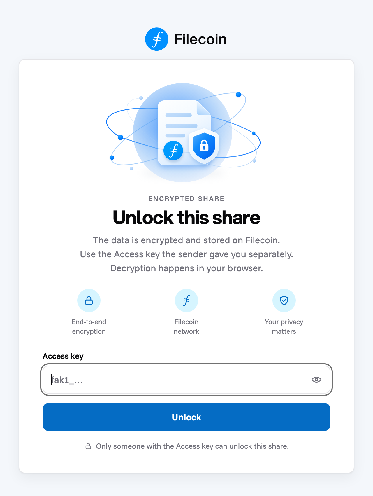
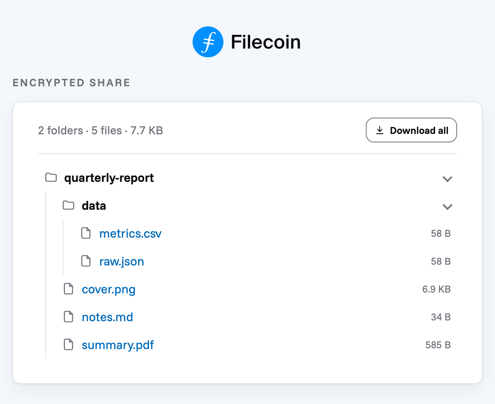

<p align="center">
  
</p>

<h1 align="center">foc-viewer</h1>

<p align="center">
  Open password-encrypted Filecoin Onchain Cloud shares in your browser. Decryption never leaves the page.
</p>

<p align="center">
  <a href="#try-it">Try it</a> ·
  <a href="#usage">Usage</a> ·
  <a href="#test-locally">Test locally</a> ·
  <a href="#verifiable-build">Verifiable build</a> ·
  <a href="#credits">Credits</a>
</p>

A single-file browser viewer for password-encrypted shares made with `filecoin-pin add --encrypt`. The build output is one self-contained `dist/index.html`, published once to IPFS and opened through [inbrowser.link](https://inbrowser.link). Decryption happens entirely in the recipient's browser. There's no server, no analytics and no storage, and the password never leaves the page.

## Try it

A working test share, on the Filecoin calibration network:

**[Open the test share](https://bafkreierah7bnqa4ah5gahnepajuqh3l5etmysc63zqzfegqwlez2deonm.ipfs.inbrowser.link/#v1/bafybeigp62fx6kv7hdluigl4ydlg7ovc7cwx3hvfqksed2zgd4g6nyvsrm)**. Password: `foc-password`

The first visit takes a few seconds while inbrowser.link sets up its service worker. This share's password is public only because it's a demo. For a real share, send the password on a separate channel from the link, never in it.

Please try it in Chrome, Firefox and Safari: open files, preview them, download one, use "Download all", and report anything that looks wrong.

## Screenshots

<table>
  <tr>
    <td align="center" width="50%">
      <picture>
        <source media="(prefers-color-scheme: dark)" srcset="docs/screenshots/unlock-dark.png" />
        
      </picture>
      <br />
      <sub>The password prompt</sub>
    </td>
    <td align="center" width="50%">
      <picture>
        <source media="(prefers-color-scheme: dark)" srcset="docs/screenshots/files-dark.png" />
        
      </picture>
      <br />
      <sub>A shared folder, with "Download all"</sub>
    </td>
  </tr>
</table>

## Origin

Taken from Jenni's [`packages/foc-viewer`](https://github.com/jennijuju/foc-encryption-demo/tree/7d5119b/packages/foc-viewer) in `jennijuju/foc-encryption-demo` at commit `7d5119b`. The rendering, sandbox, save and folder UI come from there. The archive format and the key handling have been ported to filecoin-pin's encryption format.

## Usage

```text
https://<viewer-cid>.ipfs.inbrowser.link/#v1/<encrypted-root-cid>
```

The fragment carries only the Encrypted root CID. The password is sent to the recipient on a separate channel and typed into the page. A link that carries anything else after `#v1/<cid>` is rejected with an incomplete-link message.

The viewer fetches `https://<encrypted-root-cid>.ipfs.dweb.link/` with HTTP Range requests. inbrowser.link's service worker intercepts that request and serves it from the storage providers through IPNI, so the viewer only works when opened at an inbrowser.link origin. A share opened before IPNI has caught up shows "not available yet".

Every request uses `cache: 'no-store'` and must be answered `206`. The viewer never requests a range that starts at byte 0: the gateway's service worker answers such a range by downloading the whole file in the background (js-ipfs-unixfs#501). The first request is `bytes=1-327679`, and byte 0 is supplied as `0xd0`, the COSE_Encrypt0 tag every envelope starts with.

## Encryption format

The format is defined by filecoin-pin `add --encrypt`:

```text
outer CAR (public, IPNI)  ── UnixFS file, root = Encrypted root CID
  └─ FEE envelope (chunked scheme, filecoin-encryption-envelope)
       └─ inner CAR (unixfs-v1-2025, metadata-first), root = a wrapping directory
            with exactly one entry: the shared file, or the shared folder, under its own name
```

- The envelope's `content_type` is `application/vnd.ipld.car`. The inner CAR lists every directory and file node before any file data, so the viewer knows the whole tree, and every file's byte ranges, from the first few hundred KB.
- The key is PBKDF2-SHA256 over the password. The envelope's authenticated `appMetadata` is exactly `{ "kdf": "pbkdf2-sha256", "iterations": 600000, "salt": "<base64 of 16 bytes>" }`.
- The viewer validates these fields before deriving anything, and rejects more than 10,000,000 iterations.
- File and folder names exist only inside the ciphertext. The on-chain piece name is `encrypted.fee`.

The key derivation and the CAR layout are copies of filecoin-pin's (`src/common/encryption.ts`, `src/common/unixfs-car-layout.ts`); the layout copy adds the limits listed below. A known-answer test keeps the key derivation in step. A shared golden envelope from filecoin-pin will be added once filecoin-pin #772 merges.

## Content rendering

The viewer reads the share with HTTP Range requests. It fetches only the metadata to show the tree (usually one request), and only a file's own ranges when you open it, in batches of up to 8 MiB. There is no cap on the share's size.

- **Single file:** opens straight into its file.
- **Folder:** shown as a tree under the folder's real name, with a "folders · files · size" summary. Folders open and close natively; the top folder and its direct subfolders start open.
- **"← All files":** every file view of a folder share has this button. It returns to the tree from the already-open archive, with no new fetch and no new decryption, and remembers which folders were open.
- **"Download all":** streams a ZIP of the whole folder from the open archive (no re-decryption) and saves it as `<folder>.zip`, the same way as a single file.
- **File views:** each starts with the file name, a type label and the size ("PDF · 4.9 KB"), then the preview, then a Download button.

| Entry | Rendering |
|---|---|
| HTML up to 8 MiB | Static markup in an opaque-origin iframe; scripts, handlers, refresh, forms, embedded contexts, anchors, SVG animation and navigation/resource URLs are removed |
| Text up to 8 MiB, including SVG and XML | Shown as plain text, in a scrolling box |
| Raster image (JPEG, PNG, GIF, WebP, AVIF, BMP), audio or video up to 64 MiB | Inline browser preview with a Download button |
| PDF up to 64 MiB, starting with `%PDF-` | A panel with "Open PDF in a new tab" and a Download button |
| Unknown type | A download card: file name, "Unknown file type · size" and a Download button |
| Any larger entry | A save screen with the type, the size and a Download button |

The type is detected from a bounded sniff of the decrypted bytes, never from the file name. PDFs open in the browser's own PDF viewer in a new tab, with no inline preview, so the page CSP can forbid frames and plugins. Download links are always `application/octet-stream` blobs, so a decrypted HTML or SVG file opened from a link can't run script on the viewer's origin.

### Saving

| Browser | How a file is saved |
|---|---|
| Chrome, Edge, Brave (desktop) | The save dialog (`showSaveFilePicker`), streamed straight to disk |
| Firefox 111+, Safari 26+ | Decrypted into a temporary file in the browser's private storage (OPFS), with "Decrypting… N%" progress, then downloaded from disk. Memory stays low at any size |
| Private windows, older browsers | Built in memory, capped at 512 MiB on desktop and 256 MiB on mobile. Above that: "too large to save in this browser, use `filecoin-pin decrypt`" |

Temporary OPFS files are deleted at the next save, when the page starts, and when it's closed. A Web Lock keeps another tab from deleting a file that's still in use. If the server ignores Range and sends the whole file, the viewer offers that encrypted file as a download (`encrypted.fee`), to decrypt with `filecoin-pin decrypt`.

### Limits

A share must be exactly what `filecoin-pin add --encrypt` writes. The viewer rejects anything else as "not a filecoin-pin encrypted share", and it bounds the work a crafted share can cause. A real share over the entry or path limit gets "too many files, or folders nested too deeply, to open in the browser. Use `filecoin-pin decrypt`."

| Limit | Value |
|---|---|
| Entries (files and folders) | 10,000 |
| Name / path length | 1024 / 4096 bytes |
| Metadata read before the tree shows | 16 MiB |
| Layout work | 1,000,000 visits |

## Development

Requires Node 24 and pnpm 10.7.0 (`packageManager`).

```sh
pnpm install --frozen-lockfile
pnpm dev
pnpm test
pnpm typecheck
pnpm build
```

### Test locally

`pnpm dev` alone has nothing to open. Make a local share first, then start the dev server:

```sh
pnpm dev:share ./some-folder   # or a single file; add --password <pw> to change dev-password
pnpm dev
```

Open the printed URL (`http://localhost:5173/#v1/<cid>`). The dev server answers the share's Range requests from `dev/share.fee` and relaxes the page CSP for Vite; neither exists in `pnpm build`, which fails if either leaks into `dist/index.html`. In dev, the console also logs `[foc-viewer dev]` timings for each unlock, file open and range request.

| State | How to trigger |
|---|---|
| Wrong password | Enter anything other than the printed password |
| Not available | Delete `dev/share.fee`, then submit |
| Can't be opened in the browser | Add `?ignore-range` before the `#` (`http://localhost:5173/?ignore-range#v1/<cid>`); the dev server then answers `200` with the whole file |
| Incomplete link | Use any other fragment, for example `#nope` |

The real path (the inbrowser.link service worker fetching `https://<cid>.ipfs.dweb.link/`) can only be tested on the published Viewer.

## Verifiable build

Recipients trust this page with their password, so anyone should be able to check that a Viewer CID was built from this source. The build is reproducible: lockfile, pinned Node and pnpm, and no timestamps in the output.

```sh
git checkout <commit>
pnpm install --frozen-lockfile
pnpm build
filecoin-pin add dist/index.html --dry-run   # prints the root CID without uploading
```

| Commit | Viewer CID | Network |
|---|---|---|
| `4f07fae` | `bafkreierah7bnqa4ah5gahnepajuqh3l5etmysc63zqzfegqwlez2deonm` | calibration (staging, for testing) |

The mainnet Viewer will be published once, after filecoin-pin's `--encrypt` and `decrypt` are released.

## Modules

1. `fragment.ts` parses `#v1/<cid>` fragments.
2. `password-key.ts` validates the key-derivation metadata and derives the key from the password.
3. `range-source.ts` reads the share with Range requests (`no-store`, `206` only, never byte 0).
4. `unixfs-car-layout.ts` computes the tree and every block's offset from the metadata-first CAR, within the limits above.
5. `car-archive.ts` decrypts the metadata, builds the entry list, and streams a file's ranges in batches.
6. `errors.ts` holds the error classes the UI maps to messages.
7. `decrypt.ts` bounds inline entry collection.
8. `sandbox.ts` creates the locked HTML iframe.
9. `save.ts` picks the save path (dialog, OPFS, or in-memory), and `opfs-save.ts` stages files in OPFS.
10. `render.ts` renders bounded content and the file views.
11. `file-type.ts` maps sniffed MIME types to friendly labels, and `format.ts` formats byte sizes.
12. `zip.ts` streams the "Download all" ZIP from the open archive (with [`client-zip`](https://github.com/Touffy/client-zip)).
13. `card-label.ts` manages the label above the card and the card layout per screen.
14. `ui.ts` owns the password prompt and retry, the folder tree, and the save, too-large, not-available and can't-be-opened states.
15. `main.ts` connects the link, password, archive, entry and renderer paths.

## Credits

- Fonts: Funnel Sans (body) and Aspekta (headings), under the SIL Open Font License 1.1. See `assets/fonts/OFL.txt`.

## License

MIT
